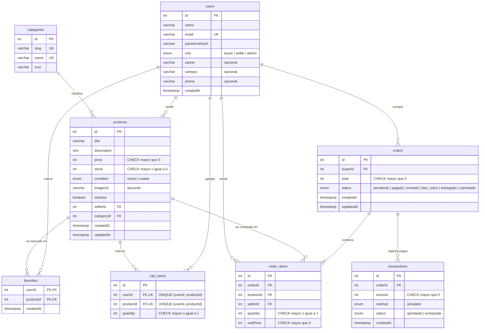

# Modelo entidad-relación (PostgreSQL)

PostgreSQL guarda todos los datos transaccionales del Marketplace UNAB: quién vende qué, quién compró qué, a qué precio y con qué resultado de pago. El modelo tiene 8 tablas. Los nombres de los campos están en camelCase, igual que en las entidades de TypeORM y en el JSON de la API.

Convenciones del modelo:

- **IDs:** enteros autoincrementales.
- **Dinero:** pesos chilenos como entero, sin decimales (`price`, `unitPrice`, `total`, `amount`).
- **Fechas:** `timestamp` en UTC.
- **Valores de estado:** en español sin tildes (`pendiente`, `nuevo`, `aprobada`...).

## 1. Diagrama

### Cardinalidades

| Relación | Cardinalidad | Lectura |
| --- | --- | --- |
| `users` → `products` (`sellerId`) | 1 a 0..N | Un usuario vende cero o muchos productos; cada producto tiene exactamente un vendedor. |
| `categories` → `products` (`categoryId`) | 1 a 0..N | Una categoría agrupa cero o muchos productos; cada producto pertenece a una categoría. |
| `users` ↔ `products` mediante `favorites` | N a M | Un usuario marca muchos productos como favoritos y un producto puede ser favorito de muchos usuarios. |
| `users` → `cart_items` (`userId`) | 1 a 0..N | El carrito de un usuario tiene cero o muchos ítems. |
| `products` → `cart_items` (`productId`) | 1 a 0..N | Un producto puede estar en el carrito de muchos usuarios, una sola vez por usuario. |
| `users` → `orders` (`buyerId`) | 1 a 0..N | Un usuario realiza cero o muchos pedidos como comprador. |
| `orders` → `order_items` (`orderId`) | 1 a 1..N | Un pedido tiene al menos un ítem (no se puede crear un pedido con el carrito vacío). |
| `products` → `order_items` (`productId`) | 1 a 0..N | Un producto puede aparecer en muchos pedidos. |
| `users` → `order_items` (`sellerId`) | 1 a 0..N | Un vendedor tiene cero o muchos ítems vendidos. |
| `orders` → `transactions` (`orderId`) | 1 a 0..N | Un pedido puede tener varios intentos de pago (por ejemplo, uno rechazado y luego uno aprobado). |

## 2. Restricciones por entidad

Todos los campos son NOT NULL, salvo los indicados como opcionales. Las claves foráneas usan el comportamiento por defecto de PostgreSQL: no se puede borrar un registro que esté referenciado por otro.

| Tabla | PK | FK | UNIQUE | CHECK / valores permitidos | Opcionales y valores por defecto |
| --- | --- | --- | --- | --- | --- |
| `users` | `id` | — | `email` | `role` ∈ `buyer`, `seller`, `admin` | `role` = `buyer` por defecto · `createdAt` = fecha actual · `career`, `campus`, `phone` opcionales |
| `categories` | `id` | — | `slug`, `name` | — | — |
| `products` | `id` | `sellerId` → `users.id` · `categoryId` → `categories.id` | — | `price` > 0 · `stock` ≥ 0 · `condition` ∈ `nuevo`, `usado` | `stock` = 1 · `isActive` = `true` · `createdAt` y `updatedAt` = fecha actual · `imageUrl` opcional |
| `favorites` | (`userId`, `productId`) compuesta | `userId` → `users.id` · `productId` → `products.id` | — (la PK compuesta impide duplicados) | — | `createdAt` = fecha actual |
| `cart_items` | `id` | `userId` → `users.id` · `productId` → `products.id` | (`userId`, `productId`) | `quantity` ≥ 1 | — |
| `orders` | `id` | `buyerId` → `users.id` | — | `total` > 0 · `status` ∈ `pendiente`, `pagado`, `enviado`, `listo_retiro`, `entregado`, `cancelado` | `status` = `pendiente` · `createdAt` y `updatedAt` = fecha actual |
| `order_items` | `id` | `orderId` → `orders.id` · `productId` → `products.id` · `sellerId` → `users.id` | — | `quantity` ≥ 1 · `unitPrice` > 0 | — |
| `transactions` | `id` | `orderId` → `orders.id` | — | `amount` > 0 · `method` ∈ `simulado` · `status` ∈ `aprobada`, `rechazada` | `method` = `simulado` · `createdAt` = fecha actual |

Además de las restricciones de la base de datos, el backend aplica estas reglas de negocio:

- `passwordHash` guarda la contraseña cifrada con bcrypt y nunca se incluye en las respuestas de la API.
- Un usuario pasa de `buyer` a `seller` al publicar su primer producto.
- Los estados del pedido solo avanzan en el orden `pendiente` → `pagado` → `enviado` / `listo_retiro` → `entregado`, con `cancelado` posible antes de `enviado`.
- Al crear un pedido se descuenta el stock dentro de una transacción SQL, y al cancelarlo se devuelve.

## 3. Decisiones de diseño

**Por qué `order_items` guarda `unitPrice` y `sellerId`.** Un pedido debe reflejar lo que se acordó al momento de comprar. Si `order_items` solo guardara `productId` y el precio se leyera desde `products`, cualquier cambio de precio posterior del vendedor alteraría el total de pedidos ya pagados y el historial dejaría de coincidir con las transacciones registradas. Por eso `unitPrice` copia el precio vigente al crear el pedido y queda fijo. `sellerId` se guarda en cada ítem porque un mismo pedido puede incluir productos de varios vendedores: así cada vendedor consulta sus ventas filtrando directamente por `sellerId`, sin depender de la tabla `products`, y el pedido sigue registrando a quién se le compró aunque el producto se modifique después.

**Por qué los productos se desactivan con `isActive` en vez de borrarse.** Los productos están referenciados desde `order_items`, `favorites` y `cart_items`. Borrar físicamente un producto rompería esas referencias o eliminaría el historial de pedidos ya realizados. Con el borrado lógico (`isActive = false`), el producto deja de aparecer en el catálogo, pero los pedidos antiguos conservan su detalle y el vendedor lo sigue viendo en "Mis publicaciones".

**Por qué `favorites` usa PK compuesta y `cart_items` un UNIQUE (`userId`, `productId`).** Ambas tablas relacionan usuarios con productos, y en ambas un usuario no puede tener el mismo producto dos veces.

- `favorites` es una tabla intermedia pura: la pareja (`userId`, `productId`) identifica el registro por completo, así que se usa directamente como clave primaria y no hace falta un `id` adicional.
- `cart_items` tiene un dato propio (`quantity`) que se modifica, y la API identifica cada ítem por su `id` (`PATCH /cart/:itemId`, `DELETE /cart/:itemId`). Por eso tiene su propio `id`, y la restricción UNIQUE (`userId`, `productId`) garantiza que agregar de nuevo un producto sume la cantidad en vez de crear una segunda fila.

## 4. Datos fuera de este modelo

Las conversaciones comprador–vendedor (`conversations`) y el historial de actividad (`activity_logs`) se guardan en MongoDB y no forman parte de este modelo; solo almacenan IDs de PostgreSQL (`productId`, `buyerId`, `sellerId`, `userId`, `orderId`), sin copiar datos de usuarios ni de productos.
