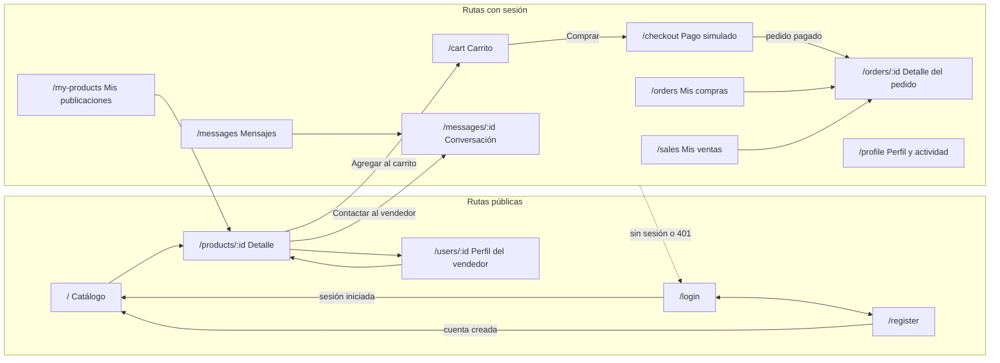

# Mapa de navegación del frontend

En el Taller 2 la aplicación era una sola pantalla: el catálogo, más modales y paneles laterales. En el Hito 3 se agrega **React Router 6** para dar a cada funcionalidad nueva su propia página (inicio de sesión, pedidos, ventas, mensajes, perfil). El catálogo, el carrito lateral y los favoritos mantienen el aspecto que tenían.

## 1. Rutas

| Ruta | Página | Qué muestra | Requiere sesión | Desde dónde se llega |
| --- | --- | --- | --- | --- |
| `/` | `HomePage` | Catálogo: encabezado, barra lateral con búsqueda y filtros (categoría, precio, condición), orden, grilla de productos con paginación. Con sesión, sección "Vistos recientemente". | No | Logo del `Navbar`; botón "Volver al catálogo" de las demás páginas; después de iniciar sesión o registrarse. |
| `/products/:id` | `ProductDetailPage` | Detalle del producto: imagen, precio, stock, condición, categoría, vendedor con enlace a su perfil, botones de favorito, agregar al carrito y "Contactar al vendedor". | No | Tarjeta de producto en `/`; "Vistos recientemente"; productos del perfil del vendedor (`/users/:id`); favoritos; "Mis publicaciones". |
| `/login` | `LoginPage` | Formulario de correo y contraseña, con los errores del servidor. Enlace a registro. | No | Botón "Iniciar sesión" del `Navbar`; redirección automática al abrir una ruta protegida sin sesión o al expirar la sesión; corazón o "agregar al carrito" sin sesión. |
| `/register` | `RegisterPage` | Formulario de registro: nombre, correo, contraseña y, opcionalmente, carrera, campus y teléfono. | No | Enlace "Crear cuenta" en `/login` y en el `Navbar`. |
| `/cart` | `CartPage` | Carrito completo: productos, selector de cantidad, eliminar, vaciar y total calculado por el servidor. Botón "Comprar". | Sí | "Ver carrito" del panel lateral del carrito (`CartOffcanvas`), abierto desde el ícono del `Navbar`. |
| `/checkout` | `CheckoutPage` | Resumen del pedido, confirmación (crea el pedido) y formulario de pago simulado. Al terminar, enlace al detalle del pedido. | Sí | Botón "Comprar" de `/cart` o "Proceder al pago" del `CartOffcanvas`. |
| `/orders` | `MyOrdersPage` | "Mis compras": pedidos del usuario con fecha, total y estado como etiqueta de color. | Sí | Menú del usuario en el `Navbar` → "Mis compras"; después de pagar en `/checkout`. |
| `/orders/:id` | `OrderDetailPage` | Detalle del pedido: productos, total, línea de tiempo de estados, transacciones y botones según rol y estado (Pagar, Cancelar, Marcar enviado / listo para retiro, Marcar entregado). | Sí (comprador o vendedor del pedido) | Un pedido en `/orders` o en `/sales`; resultado del pago en `/checkout`. |
| `/sales` | `MySalesPage` | "Mis ventas": pedidos que incluyen productos del usuario, solo con sus propios ítems, y su estado. | Sí | Menú del usuario en el `Navbar` → "Mis ventas". |
| `/my-products` | `MyProductsPage` | "Mis publicaciones": todos los productos del usuario (también los desactivados) con stock, editar y desactivar (con confirmación). | Sí | Menú del usuario en el `Navbar` → "Mis publicaciones"; después de publicar un producto. |
| `/messages` | `MessagesPage` | Bandeja de conversaciones: imagen y título del producto, la otra persona, último mensaje y cantidad de no leídos. | Sí | Menú del usuario en el `Navbar` → "Mensajes" (con contador de no leídos). |
| `/messages/:id` | `ConversationPage` | Conversación sobre un producto: mensajes en burbujas, campo para escribir y actualización automática cada 5 segundos. | Sí (solo participantes) | Una conversación de `/messages`; botón "Contactar al vendedor" en `/products/:id`. |
| `/profile` | `ProfilePage` | Perfil propio: datos editables (nombre, carrera, campus, teléfono) y pestaña "Mi actividad" con el historial del usuario. | Sí | Menú del usuario en el `Navbar` → "Perfil". |
| `/users/:id` | `UserProfilePage` | Perfil público de un vendedor: nombre, carrera, campus y sus productos activos. Sin correo ni teléfono. | No | Enlace al vendedor en `/products/:id`. |

Todas las páginas comparten el mismo layout: `Navbar` arriba, contenido de la ruta en el centro y pie de página.

## 2. Elementos que no son rutas

Estos componentes del Taller 2 se mantienen como modales o paneles laterales sobre la página actual:

| Componente | Tipo | Se abre desde | Requiere sesión |
| --- | --- | --- | --- |
| `ProductFormModal` | Modal | Botón "Publicar producto" del `Navbar` (crear); botón "Editar" en `/my-products` (editar). | Sí |
| `BookSearchModal` | Modal | Botón "Buscar libros" del `Navbar` o del encabezado de `/`; botón "Buscar en Open Library" dentro de `ProductFormModal`. Al elegir un libro se abre `ProductFormModal` con los datos completados. | Para buscar, no; para publicar, sí |
| `CartOffcanvas` | Panel lateral | Ícono del carrito en el `Navbar`. Lleva a `/cart` y a `/checkout`. | Sí |
| `FavoritesOffcanvas` | Panel lateral | Ícono de favoritos en el `Navbar`. Cada favorito lleva a `/products/:id` o se puede mover al carrito. | Sí |
| `ConfirmDialog` | Modal | Acciones que necesitan confirmación: desactivar un producto, vaciar el carrito, cancelar un pedido. | Sí |

## 3. Menú del `Navbar`

| Sin sesión | Con sesión |
| --- | --- |
| Logo (→ `/`) | Logo (→ `/`) |
| Buscar libros (modal) | Buscar libros (modal) |
| Iniciar sesión (→ `/login`) | Publicar producto (modal) |
| Crear cuenta (→ `/register`) | Favoritos (panel lateral, con contador) |
| | Carrito (panel lateral, con contador) |
| | Menú con el nombre del usuario: Perfil (`/profile`), Mis publicaciones (`/my-products`), Mis compras (`/orders`), Mis ventas (`/sales`), Mensajes (`/messages`, con contador de no leídos) y Cerrar sesión |

Cualquier usuario puede comprar y vender, así que el menú es el mismo para compradores y vendedores. La gestión de categorías del administrador no tiene página en el frontend: se realiza a través de la API (documentada en Swagger).

## 4. Reglas de acceso y redirección

- **Rutas protegidas:** `/cart`, `/checkout`, `/orders`, `/orders/:id`, `/sales`, `/my-products`, `/messages`, `/messages/:id` y `/profile` están envueltas en un componente `ProtectedRoute`. Sin sesión, redirige a `/login`.
- **Acciones protegidas en páginas públicas:** sin sesión, el corazón de favoritos, "Agregar al carrito", "Contactar al vendedor" y "Publicar producto" llevan a `/login`.
- **Sesión expirada:** si la API responde 401 (token inválido o vencido), se cierra la sesión y se redirige a `/login`.
- **Cerrar sesión:** borra el token y vuelve a `/`.
- **Permisos sobre datos ajenos:** si la API responde 403 o 404 (por ejemplo, al abrir el pedido o la conversación de otra persona), la página muestra el mensaje de error en vez del contenido.

## 5. Diagrama de navegación

El `Navbar` está disponible en todas las páginas y da acceso directo a `/`, `/login`, `/register`, `/cart` (a través del panel lateral), `/orders`, `/sales`, `/my-products`, `/messages` y `/profile`. Para que el diagrama se lea con claridad, esas flechas no se dibujan.
